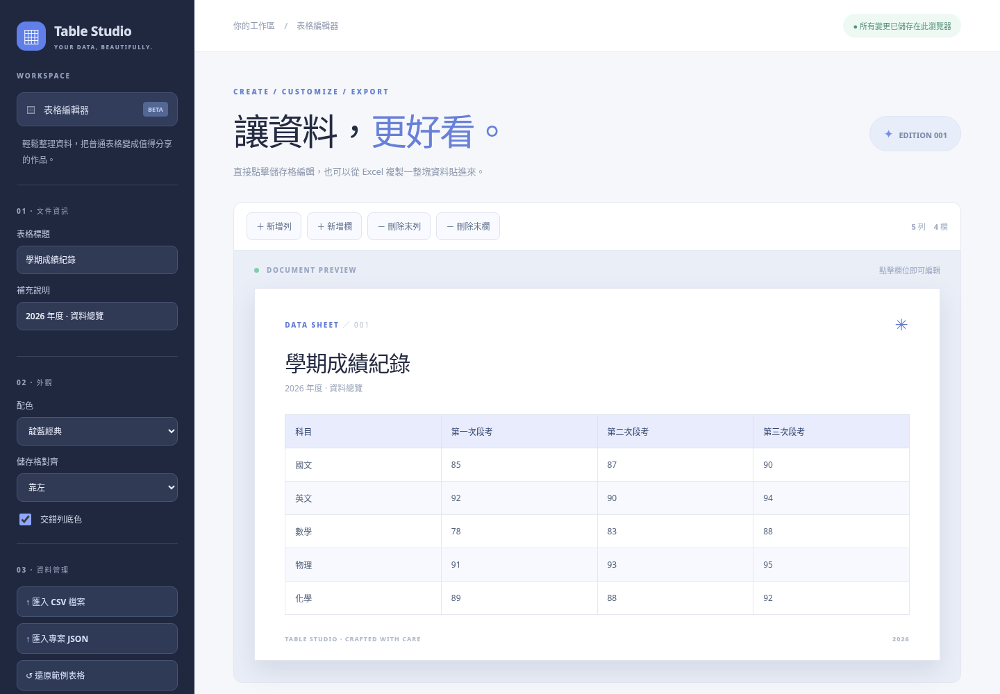

# Small Things Lab — GitHub Pages 網頁工具初版

這份試作包收錄三個**不需要後端、資料庫伺服器或 API 金鑰**的 Web App，以及一個作品入口首頁。你可以直接將整個資料夾作為一個 GitHub Pages 專案發布，也可以將三個工具拆成獨立倉庫。

| 專案 | 入口 | 目前已完成 |
| --- | --- | --- |
| Schedule Studio | `schedule-studio/index.html` | 課表格子編輯、5–7 天、4–12 節、配色、設定自動儲存、PNG/JSON 匯出與 JSON 匯入 |
| Table Studio | `table-studio/index.html` | 表格儲存格編輯、增減列欄、整區貼上、CSV/JSON 匯入、PNG/CSV/Markdown/JSON 匯出 |
| AstroCatalog | `astro-catalog/index.html` | 35 筆精選梅西爾天體搜尋、分類篩選、收藏、幾何高度角曲線、望遠鏡視野尺寸試算 |

## 介面預覽





## 本機測試

直接以瀏覽器開啟根目錄的 `index.html`，即可測試三個工具。為了模擬正式網站的網址與瀏覽器儲存行為，建議改用簡易靜態 HTTP 伺服器：

```bash
python3 -m http.server 8000
```

然後開啟 `http://localhost:8000`。上述 Python 指令只是本機開發用的靜態檔案伺服器，**上線不需要執行 Python**。

## GitHub Pages 部署

1. 新增一個公開 GitHub Repository，例如 `small-things-lab`。
2. 將 `index.html` 與三個子資料夾推送至 Repository 的 `main` 分支。
3. 前往倉庫的 **Settings → Pages → Build and deployment**。
4. Source 選 **Deploy from a branch**，分支選 `main`，資料夾選 `/ (root)`，儲存。
5. 網站網址將是 `https://<username>.github.io/small-things-lab/`。由於所有資源都採相對路徑，放在子路徑下也能正常運作。

### 拆成獨立網站

各工具的子資料夾都包含自己的 `index.html`、CSS 與 JS，沒有相互引用。把其中一個子資料夾內的檔案放到新倉庫的根目錄，就能獨立發布，例如：

`https://<username>.github.io/schedule-studio/`

## 資料與隱私

- 課表與表格使用瀏覽器的 `localStorage` 儲存；天體收藏清單也存在本機。
- 所有匯出作業都在瀏覽器完成，不會傳送使用者資料到後端。
- 字型目前有外部 Google Fonts 載入，但載入失敗會改用系統字型，不影響主要功能。若希望完全不對外連線，可刪除 CSS 的 `@import`。
- 清除瀏覽器網站資料可能會失去本機資料，建議定期匯出 JSON。
- 不提供跨裝置同步、雲端備份或帳號登入。

## 初版限制

- **Schedule Studio**：課程每格獨立編輯，暫不支援跨節課程合併、拖曳或自動排課。PNG 匯出不依賴截圖函式庫，而是使用 Canvas 重新繪製。
- **Table Studio**：不是 Excel 替代品，不支援公式、合併儲存格或 XLSX 匯入；CSV 文字以盡量避免試算表公式注入的方式匯出。PNG 為避免過大畫布，最多可匯出 60 列、12 欄；完整資料可使用 CSV。
- **AstroCatalog**：目前只有 35 筆精選資料；座標以 J2000 為主，高度角計算未納入歲差、章動、視差、折射、地形或即時大氣條件。FOV 顯示僅比較角直徑，不是精確星圖或實際照片。

## 天文資料來源

AstroCatalog 的精選天體資料依照 [Bretton Wade / Yale Bright Star Catalog — Messier JSON](https://github.com/brettonw/YaleBrightStarCatalog) 整理，原專案採 MIT 授權。中文名稱是此試作版另外整理的顯示欄位。專案中保留出處與來源說明；正式擴充資料庫時應再次核對各資料集的授權要求。

## 專案狀態

`v0.1.0` — 初版試作，可用來驗證互動流程與介面設計。尚未執行跨瀏覽器完整測試，不應視為正式發行版。
